# 🤖 Practical Report 6 — Exploring Transformers

> **Deep Learning Practical | NLP | Attention | Encoder–Decoder Models | Inference**
>
> This project explores Transformer architecture and pretrained language models through hands-on experiments, visualizations, evaluation, and a small integrated NLP toolkit.

---

## 📌 Project Overview

This practical investigates how Transformer models process and generate text. It covers self-attention, multi-head attention, positional encodings, normalization, encoder and decoder architectures, cross-attention, inference strategies, and evaluation of pretrained models.

The notebook uses pretrained models and does **not** train or fine-tune them.

🎥 **Video:** [`Explanation Video`](https://drive.google.com/file/d/1dyl48J4srtE-wqF76ArJWylJC0tDCqZO/view?usp=sharing)


## 🎯 Objectives

- Understand tokenization, padding, and the Transformer architecture.
- Implement scaled dot-product attention and examine attention patterns.
- Visualize multi-head attention, attention entropy, and positional encodings.
- Inspect encoder-only and decoder-only attention behavior.
- Explore encoder–decoder cross-attention with T5-small.
- Compare generation and KV-cache inference behavior.
- Evaluate sentiment classification on a reproducible sample of IMDB reviews.
- Study the effect of sequence length on performance and runtime.
- Build a `text_toolkit(text)` function for sentiment, summarization, and French translation.

## 🧠 Models Used

| Model | Architecture | Practical use |
|---|---|---|
| `distilbert/distilbert-base-uncased-finetuned-sst-2-english` | Encoder-only | Sentiment classification and encoder attention inspection |
| `openai-community/gpt2` | Decoder-only | Autoregressive text generation and causal attention |
| `t5-small` | Encoder–decoder | Text-to-text tasks, summarization, translation, and cross-attention |

**Note:** Model output quality depends on the pretrained checkpoint and prompt. Generated facts, summaries, and translations should be independently checked.

## 🧰 Tech Stack

- Python
- PyTorch
- Hugging Face Transformers
- Hugging Face Datasets
- NumPy and pandas
- Matplotlib and Seaborn
- scikit-learn
- Jupyter Notebook / VS Code

## 📚 Practical Tasks

### Task 1 — Introduction, Tokenization & Model Anatomy
- Transformer history and impact
- Sentiment pipeline and tokenizer exploration
- Batching, padding, and model anatomy

### Task 2 — Self-Attention
- Query, Key, and Value concepts
- Scaled dot-product attention from scratch
- Scaling experiment and Luong attention comparison
- Order-blindness demonstration
- DistilBERT attention inspection

### Task 3 — Multi-Head Attention & Positional Information
- Real attention head extraction
- Attention entropy comparison
- Sinusoidal and learned positional embeddings
- Layer Normalization and Batch Normalization comparison

### Task 4 — Encoder & Masked Attention
- DistilBERT encoder inspection and parameter distribution
- Fill-mask example
- Bidirectional attention heatmap
- Causal masking and padding-mask comparison

### Task 5 — Decoder, Cross-Attention & Inference
- Decoder and cross-attention concepts
- T5 translation/summarization experiments
- T5 cross-attention visualization
- GPT-2 greedy decoding and generation strategies
- KV-cache timing and model-family comparison

### Task 6 — Evaluation & Mini Application
- Sentiment metrics on 200 IMDB test reviews
- Truncation study at 64, 128, 256, and 512 tokens
- Forward-pass timing at multiple sequence lengths
- GPT-2 factual-prompt hallucination check
- `text_toolkit(text)` integration
- Reflection and notebook quality checks

## 📊 Output Visualizations

The `output/` folder contains selected generated figures from the practical. The images below are embedded directly in this README.

### 1. Self-Attention & Attention Heads

**Scaled Dot-Product Self-Attention**

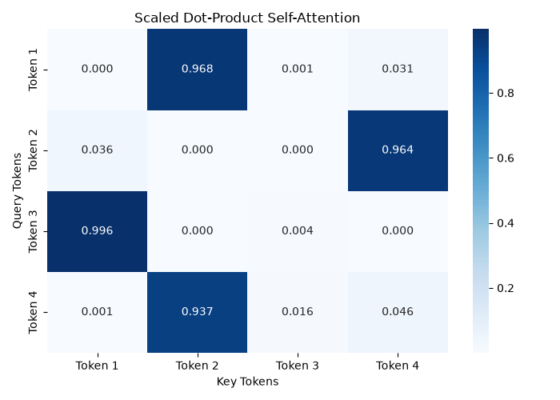

**DistilBERT Attention Heads**

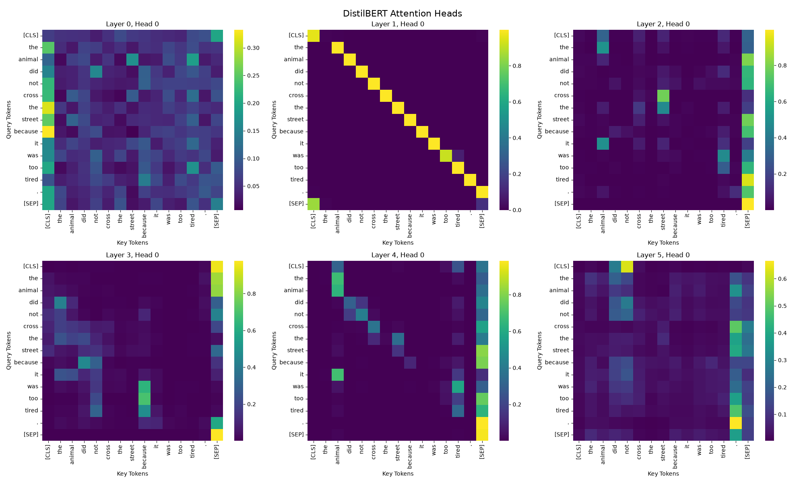

**Attention Entropy Across Heads**

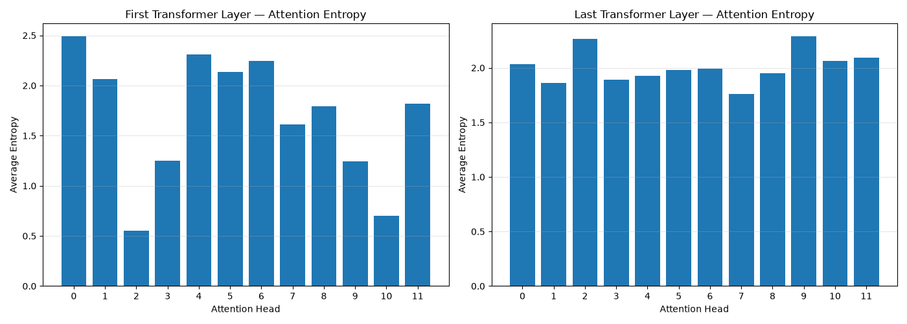

**DistilBERT Average Attention**

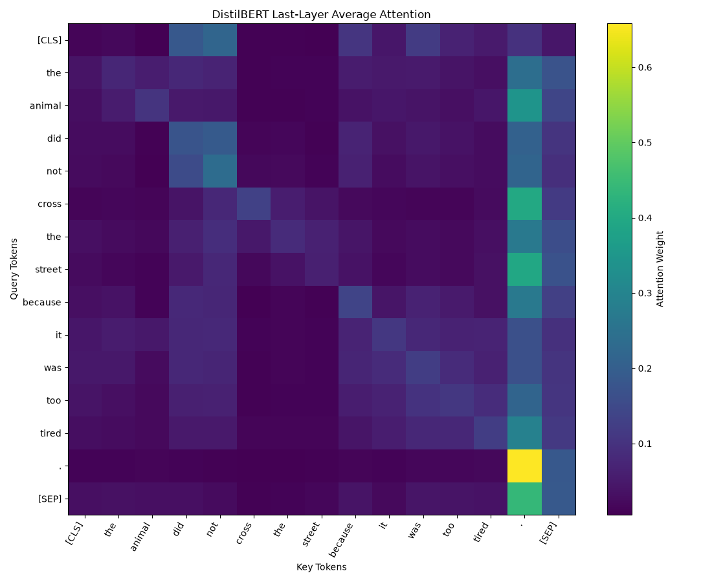

### 2. Positional Encodings

**Sinusoidal Positional Encoding**

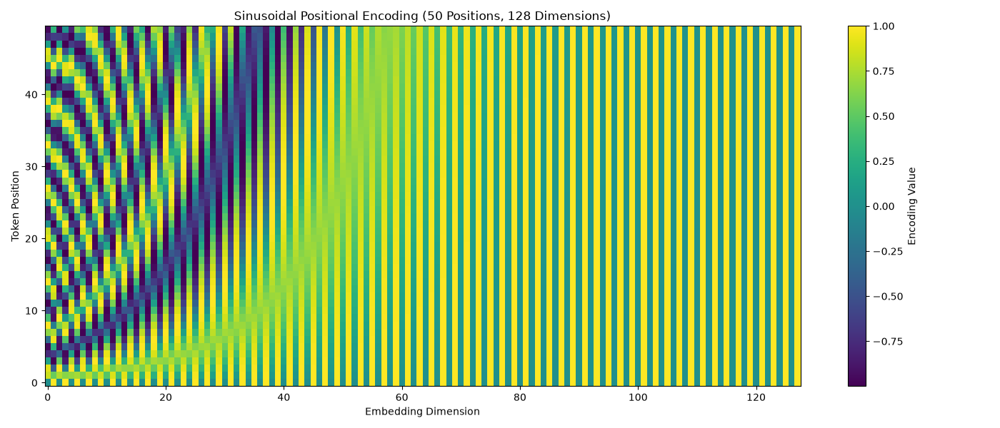

**Learned Positional Embedding Similarity**

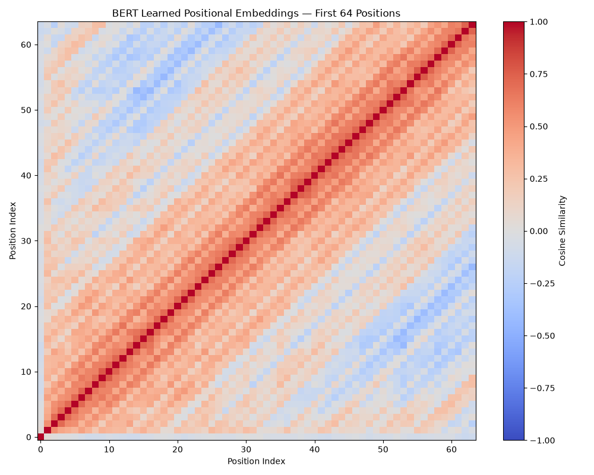

### 3. Encoder / Decoder Attention

**Causal Masked Self-Attention**

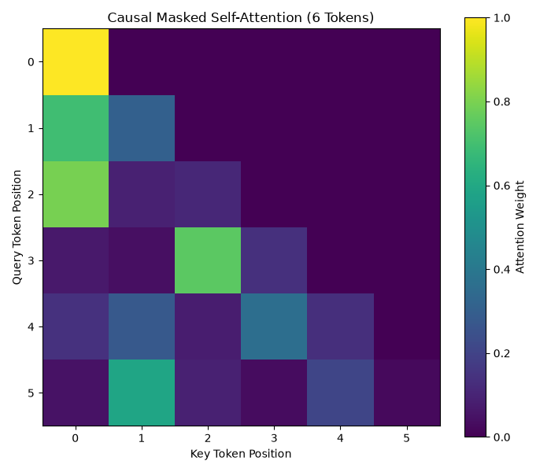

**GPT-2 Causal Attention**

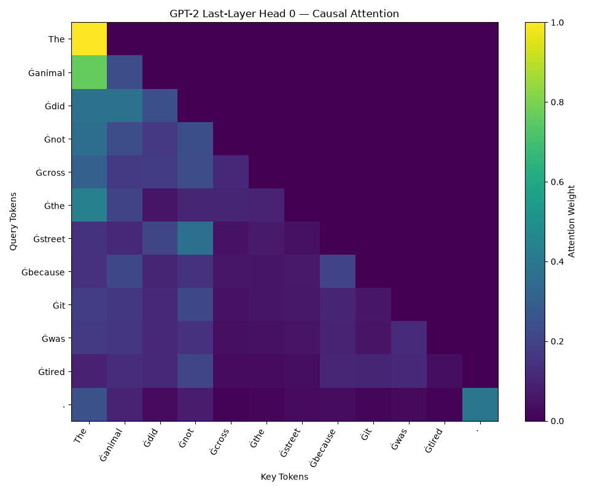

**T5 Cross-Attention: English to French**

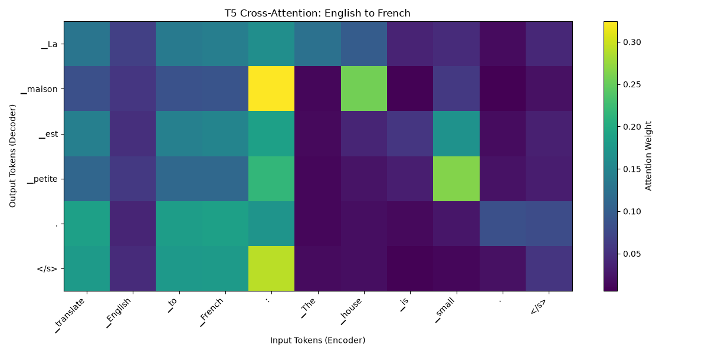

**DistilBERT Attention Heatmap**


### 4. Model Analysis & Inference

**DistilBERT Parameter Distribution**

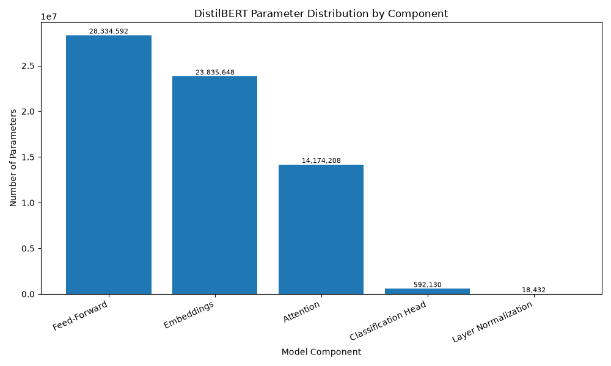

**KV Cache vs No Cache**

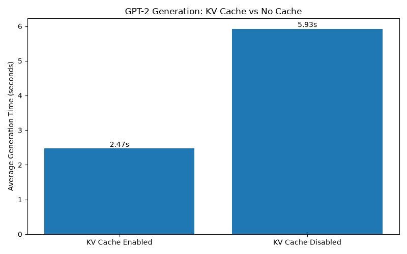

**Performance and Inference Time vs Maximum Token Length**

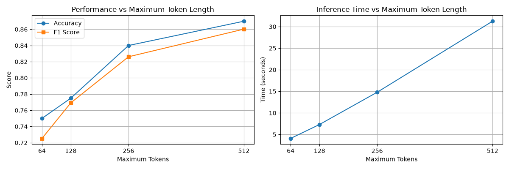

## 🧪 IMDB Evaluation

The notebook loads the public IMDB test split and selects a reproducible sample of 200 reviews using `seed=42`. It evaluates the pretrained DistilBERT sentiment classifier using:

- Accuracy
- Precision
- Recall
- F1 score
- Confusion matrix

Metrics depend on the selected model, token limit, library versions, and runtime environment. Refer to the notebook's actual output cells for the measured values.

## 🧩 Integrated Text Toolkit

The `text_toolkit(text)` function returns a dictionary containing:

- `sentiment`: predicted sentiment label
- `sentiment_score`: predicted class probability
- `summary`: generated summary
- `french_translation`: French translation of the summary

It includes handling for empty inputs and truncates inputs to the supported model token limit. T5-small's generated summaries and translations may be imperfect and should be reviewed.

## ⚙️ Setup

### 1. Clone or copy the project

Place `Pr_6.ipynb` and `requirements.txt` in your project folder. Keep the `output/` folder beside them if you want the README images to render.

### 2. Create and activate a virtual environment

**Windows PowerShell:**

```powershell
python -m venv .venv
.\.venv\Scripts\Activate.ps1
```

### 3. Install dependencies

```bash
python -m pip install --upgrade pip
python -m pip install -r requirements.txt
```

Select the `.venv` interpreter/kernel in VS Code before running the notebook.

### 4. Run the notebook

Open `Pr_6.ipynb` in VS Code or Jupyter and run cells in order. The first run may download model weights and the IMDB dataset, so an internet connection is required. Ensure that all cells run successfully using **Restart Kernel → Run All**.

## 📁 Suggested Project Structure

```text
PR6/
├── Pr_6.ipynb
├── requirements.txt
├── README.md
└── output/
    ├── t5_cross_attention.png
    ├── 4x4_attention_heatap.png
    ├── 6_attention_head_heatmap.png
    ├── attention_entropy.png
    ├── attention_heatmap.png
    ├── avg_attention_heatmap.png
    ├── causal_selfattention_matrix.png
    ├── component_dist.png
    ├── gpt2_attention_heatmap.png
    ├── kv_vs_no_cache.png
    ├── perfomance_timevs_maxtokenlentght.png
    ├── position_enc_matrix.png
    └── positional_encoding.png
```

## ✅ Submission Checklist

- [x] Notebook contains all required tasks and explanations.
- [x] All code cells run from top to bottom without errors.
- [x] Plots have titles, axis labels, and readable token labels.
- [x] Evaluation metrics and confusion matrix are visible.
- [x] Generated GPT-2 responses are manually graded.
- [x] The integrated toolkit is tested on three passages and empty input.
- [x] `requirements.txt` is included.
- [x] Output images are included in `output/`.
- [x] Notebook and HTML export are saved if required by the instructor.

## ⚠️ Notes & Limitations

- Pretrained model outputs are not guaranteed to be factually correct.
- T5-small may not produce high-quality summaries or translations for every input.
- Timing results vary with CPU/GPU hardware, batch size, sequence length, and system load.
- The notebook uses pretrained models only; it does not fine-tune or train the model weights.
- The included figures are the supplied outputs; not every figure is necessarily produced by every notebook run.

## 👨‍🎓 Conclusion

This practical demonstrates the key building blocks of Transformer models—from tokenization and self-attention to encoder/decoder architectures and text generation. The experiments connect theory with observable attention maps, performance measurements, and a small multi-task NLP application.

---

**Made with 🧠 Transformers, 🐍 Python, and 🤗 Hugging Face**
